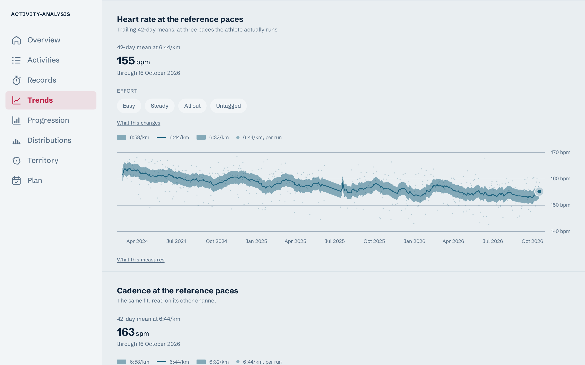
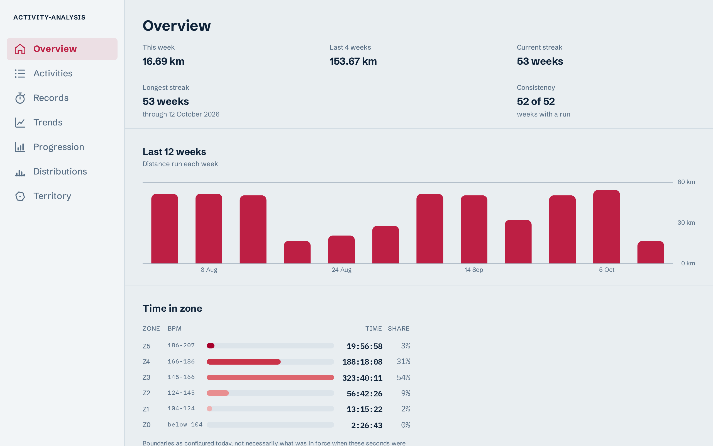
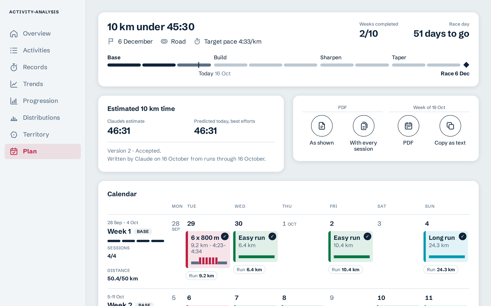
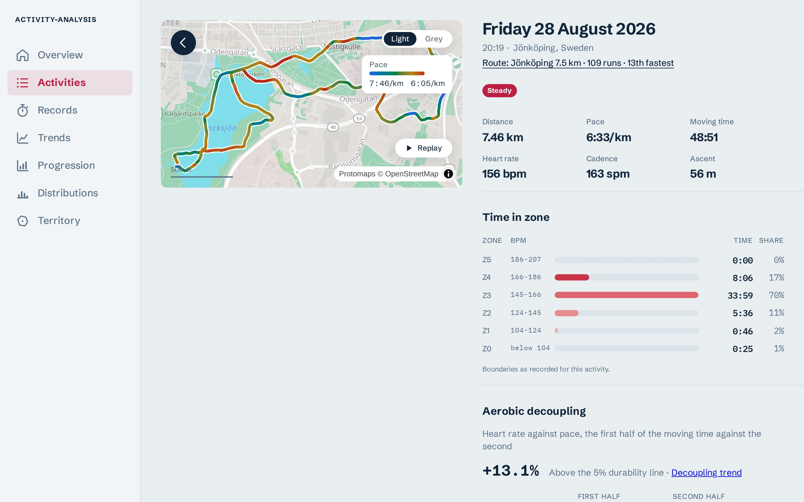
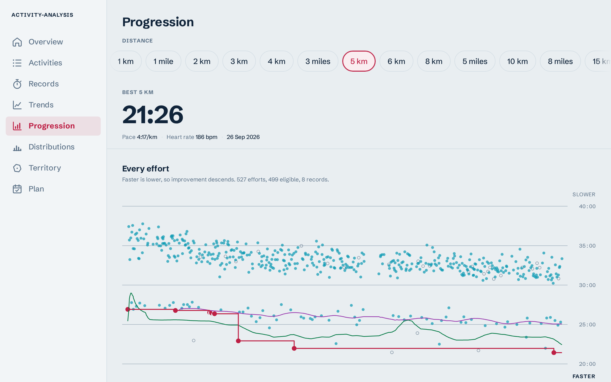
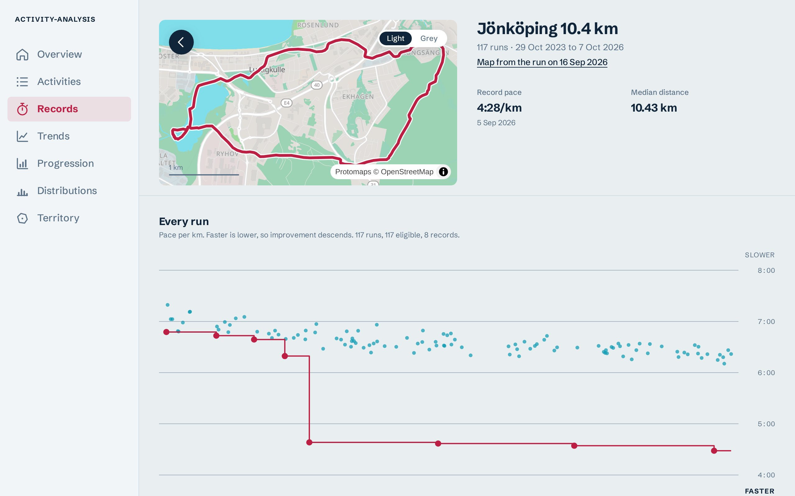
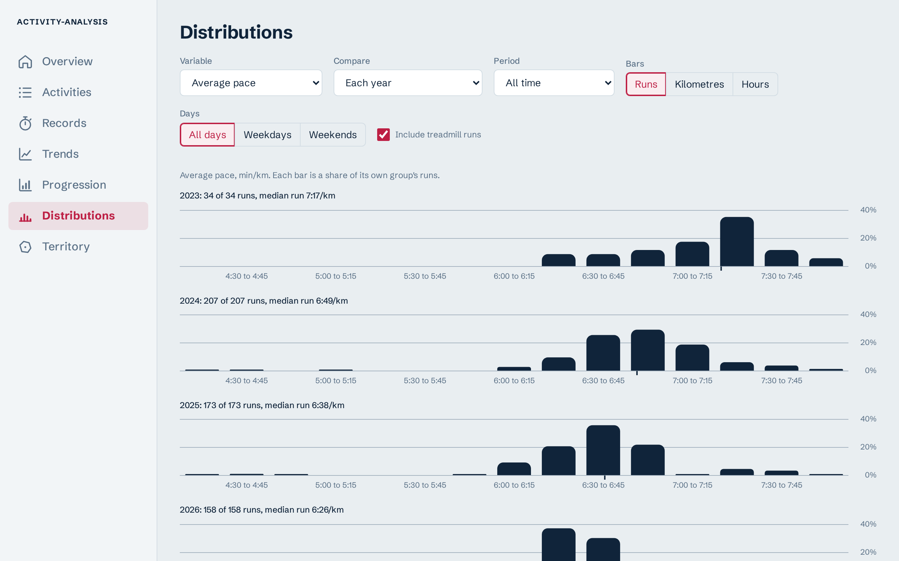
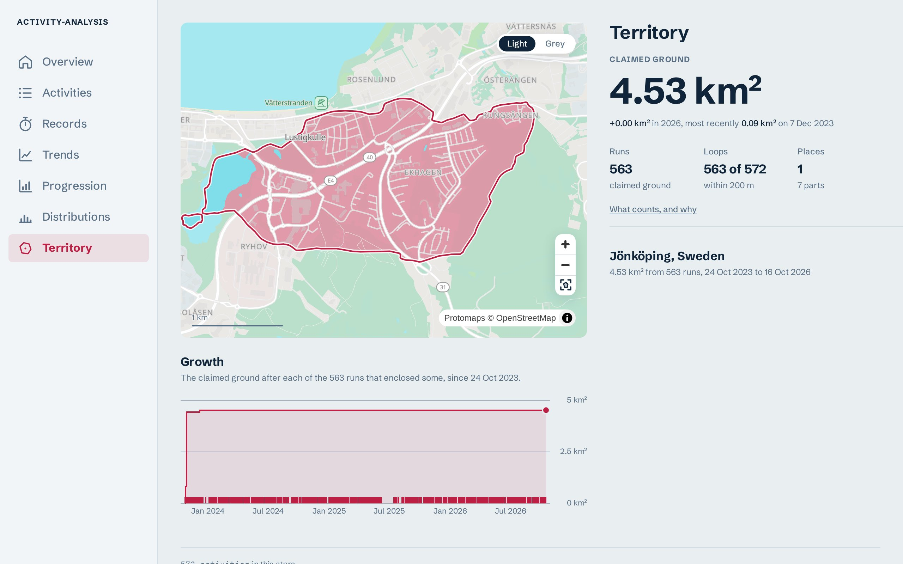

# activity-analysis

Training analysis for runners, from your own Strava or Garmin Connect export, on your own machine.



*Every screenshot here shows the demo store, synthetic runs built from the five committed sample activities; see [Contributing](#contributing).*

## Why this exists

Strava and Garmin both show you what you did.
Neither tells you clearly whether you are getting fitter.

Raw metrics plotted over time mostly measure circumstance.
Average heart rate went up because the run was faster; cadence went down because the run was slower.
This project normalises for those circumstances and plots what is left:

- **Heart rate at a fixed reference pace**, the direct aerobic fitness signal. Falling means fitter.
- **Cadence at a fixed reference pace**, so a change in form is separated from a change in pace.
- **Aerobic decoupling**, first-half against second-half efficiency, as a measure of endurance durability.
- **Race predictions** at the classic distances from a kilometre up, from your real best efforts and from ordinary running.

## What it shows

**Overview**: this week, the last four weeks, streaks, weekly distance and time in heart rate zones.



**Plan**: a training plan toward a race that Claude Code writes and revises from your runs, drawn as a calendar beside the runs done, with heart-rate targets, weekly load and the fitness the plan is expected to reach; see [Training plans](#training-plans).



<details>
<summary><b>The other views</b>: an activity, Trends, Progression, Records, Distributions and Territory</summary>

**An activity**: the route coloured by pace on a basemap, a replay, pace, heart rate, cadence and elevation streams, splits, laps, zones, best efforts and aerobic decoupling.



**Trends**: heart rate and cadence at three reference paces, decoupling, VO2max from two methods beside Garmin's own, the race predictions, and the weekly training load with fitness, fatigue and form, over a period you pick.

**Progression**: every effort at a distance over time, with the record staircase.



**Records**: the best effort at each distance, and recurring routes, each with its runs ranked.



**Distributions**: any of fifteen per-run variables as a histogram, comparing two periods, weekdays and weekends, outdoor and treadmill, or each year.



**Territory**: all the ground your outdoor loops have ever enclosed, and how it grew.



</details>

## Getting started

The app runs in your web browser.
You install it by pasting a few commands into a terminal, and no programming is involved.

You need a 64-bit computer running macOS, Windows or Linux, an export of your Strava or Garmin Connect account, and an internet connection while setting up.
The app takes about 500 MB of disk, plus room for your unpacked export.

<details>
<summary>The requirements in detail</summary>

- **Windows on ARM**, such as laptops with a Snapdragon chip, is not supported yet, because pyarrow, a library the app needs, publishes no build for it.
  The app has been run on Windows 11 and Linux, and not yet on a Mac.
- **Disk**: 370 MB for the app and its libraries and 110 MB for Python.
  The app keeps a copy of your export: a Garmin export whose zip is 109 MB unpacks to 464 MB, and the app's folder came to 588 MB.
- **What is installed for you**: [uv](https://docs.astral.sh/uv/), which installs and runs the app; Python 3.12, which uv downloads if the computer lacks that version, without changing any Python already there; and [pmtiles](https://github.com/protomaps/go-pmtiles) 1.31.2, only for the map.
  None of it needs administrator rights.

</details>

### 1. Request your export

Strava takes up to a few hours to prepare an export and Garmin usually up to two days, so ask for it first:

- **Strava**: on the website, Settings, **My Account**, **Download your account**, **Get Started**, then **Request download**.
- **Garmin Connect**: at [Garmin Account Data Management](https://www.garmin.com/account/datamanagement/), **Export Your Data**, then **Request Data Export**.

Both email you a link to a `.zip` file; download it.
If your runs come from a Garmin watch, use the Garmin export: it carries the watch's original files and your daily resting heart rate.

<details>
<summary>What each export holds, and using both</summary>

Strava's zip holds `activities.csv` and an `activities/` folder with each activity's file as it was uploaded, gzipped.
It can also hold your photos and videos under `media/`, which the app does not need; deleting that folder from the zip makes it smaller.

Garmin's zip holds `DI_CONNECT/`, with the original FIT files from the watch in further zips, which the app unpacks itself.
It also reads Garmin's own VO2max, which the Trends view draws beside its two estimates, and the daily resting heart rate, which the training load is weighed against.
Without it, the load is weighed against the resting heart rate set on the watch.

Ingesting both exports is safe: a run present in both is stored once, and the Garmin copy wins.
A newer export of the same account adds only what is new.

FIT is what the analysis needs.
A GPX file has no laps, no heart rate zones and no athlete profile, and its speed has to be derived from positions: on the committed sample run the GPX copy carries 10.2 times the second-to-second speed noise of the FIT file.
GPX activities are read and flagged, and the trend analyses leave them out.
TCX files are listed as not read.

There is no live integration: the Strava API endpoints that carry stream data need a paid subscription.

</details>

### 2. Install and start the app

Open a terminal: **Terminal** on macOS, **PowerShell** on Windows.
Paste the command for your system and press Enter.

On macOS or Linux:

```bash
curl -LsSf https://raw.githubusercontent.com/KodAgge/activity-analysis/HEAD/install.sh | sh
```

On Windows:

```powershell
powershell -ExecutionPolicy ByPass -c "irm https://raw.githubusercontent.com/KodAgge/activity-analysis/HEAD/install.ps1 | iex"
```

The script installs uv and the app, asks you to drag your export onto the terminal window, asks before downloading the map, and then starts the app in your web browser.
Run it again after a newer export, or to update the app: it skips whatever is already done.
The scripts are [`install.sh`](https://github.com/KodAgge/activity-analysis/blob/HEAD/install.sh) and [`install.ps1`](https://github.com/KodAgge/activity-analysis/blob/HEAD/install.ps1).

<details>
<summary>Installing step by step instead</summary>

**Install uv**, which installs the app and the Python it needs.
On macOS or Linux:

```bash
curl -LsSf https://astral.sh/uv/install.sh | sh
```

On Windows:

```powershell
powershell -ExecutionPolicy ByPass -c "irm https://astral.sh/uv/install.ps1 | iex"
```

Homebrew's `brew install uv` and Windows' `winget install --id=astral-sh.uv -e` work too.

**Install the app.** Open a new terminal, so that it finds `uv`, then run:

```bash
uv tool install --python 3.12 https://github.com/KodAgge/activity-analysis/releases/download/v0.3.0/activity_analysis-0.3.0-py3-none-any.whl
```

That is release 0.3.0; the [releases page](https://github.com/KodAgge/activity-analysis/releases/latest) has the newest, whose `.whl` link goes in the same command.
`--python 3.12` makes uv download Python 3.12 when the computer lacks it, since an older Python fails the install.
If the terminal then cannot find `activity-analysis`, run `uv tool update-shell` and open a new terminal.

**Load your export.** Type `activity-analysis ingest ` and drag the zip, or the folder it unpacked to, onto the terminal window, then press Enter:

```bash
activity-analysis ingest ~/Downloads/export_12345678.zip
```

`ingest` copies the export into the app's folder and computes everything the views show.
A Garmin export of about 2900 activities took 7 minutes on Linux and 21 minutes on Windows on the same computer.

**Download the map**, if you want routes drawn on one: see [Maps](#maps).

**Start the app:**

```bash
activity-analysis serve --open
```

It opens [http://127.0.0.1:8000](http://127.0.0.1:8000) and runs until you press Ctrl+C or close the terminal.

</details>

### After that

- **To use the app again**, run `activity-analysis serve --open`.
- **After a newer export**, run the setup script again, or `activity-analysis ingest` the new zip and restart the app. Only new activities are read.

The app keeps your data in one folder, which `activity-analysis info` prints:

- macOS: `~/Library/Application Support/activity-analysis`
- Windows: `%LOCALAPPDATA%\activity-analysis`
- Linux: `~/.local/share/activity-analysis`, or `$XDG_DATA_HOME/activity-analysis` when that is set

Deleting the folder removes all of it, and `uv tool uninstall activity-analysis` removes the app.
`ACTIVITY_ANALYSIS_HOME`, or `--root` on any command, puts the store in another folder.

## Privacy

Everything stays on your machine, and `serve` listens only on `127.0.0.1` unless `--host` names another interface, which it warns about, since the API has no authentication.
The one exception is optional: `tiles`, below, sends the box around each area you have run in to the Protomaps build host to download that part of the map.
`--dry-run` shows what it would send.

## Maps

Without a basemap each route is drawn as a bare trace.
The setup script downloads the map for you.
By hand, `activity-analysis tiles` downloads the parts of the map your runs need, using the [`pmtiles` program](https://github.com/protomaps/go-pmtiles/releases/tag/v1.31.2), version 1.31.2.

<details>
<summary>Downloading the map by hand</summary>

These commands download `pmtiles` into the folder the terminal is in and run `tiles` with it.

On a Mac with an Apple chip, or with `Darwin_x86_64` in place of `Darwin_arm64` on an Intel chip:

```bash
curl -LO https://github.com/protomaps/go-pmtiles/releases/download/v1.31.2/go-pmtiles-1.31.2_Darwin_arm64.zip
unzip go-pmtiles-1.31.2_Darwin_arm64.zip pmtiles
activity-analysis tiles --pmtiles ./pmtiles
```

On Windows:

```powershell
curl.exe -LO https://github.com/protomaps/go-pmtiles/releases/download/v1.31.2/go-pmtiles_1.31.2_Windows_x86_64.zip
Expand-Archive go-pmtiles_1.31.2_Windows_x86_64.zip pmtiles
activity-analysis tiles --pmtiles .\pmtiles\pmtiles.exe
```

On Linux, or with `Linux_arm64` in place of `Linux_x86_64` on ARM:

```bash
curl -L https://github.com/protomaps/go-pmtiles/releases/download/v1.31.2/go-pmtiles_1.31.2_Linux_x86_64.tar.gz | tar xz pmtiles
activity-analysis tiles --pmtiles ./pmtiles
```

Reload the app's page afterwards.
`tiles` fetches boxes of map, at least 10 x 10 km each, that between them hold every stored run, and never fetches an area it already has.
Run it again after ingesting runs somewhere new; with `pmtiles` on `PATH`, `--pmtiles` can be left out.

</details>

## Training plans

[Claude Code](https://code.claude.com/docs/en/overview), Anthropic's coding agent, writes a training plan toward a race from your runs and revises it each week from the runs you have done since.
The app gathers the figures Claude plans from, checks the plan it writes and stores every version; the coaching is Claude's.
Easy runs are steered by heart rate, on five zones estimated from your own hard efforts, and each week's load is planned in TRIMP, which weighs time by heart rate.

You need the app with your export loaded, Claude Code installed and signed in, and [Git](https://git-scm.com/downloads).
The plan is written by the `/training-plan` skill, which comes with a copy of this repository rather than with the installed app.
Make the copy once:

```bash
git clone https://github.com/KodAgge/activity-analysis
cd activity-analysis
uv sync
```

Commands run there with `uv run` read the same store as the installed app.

**To make a plan**, start Claude Code with `claude` in the `activity-analysis` folder and type `/training-plan`.
Claude reads your recent runs, then asks one question at a time: the race distance, target time, race date and surface, how many runs a week and on which days, track access, injuries and other sports.
It estimates the time your recent best efforts support, writes the plan, checks it with `activity-analysis plan` and stores it as a proposal.
Open the app's **Plan** view to read it, then tell Claude to accept or reject it.

**Each week**, load the week's runs, run `/training-plan` again and accept or reject the revision.
Claude judges each past session against what you ran and changes the coming weeks where the runs call for it, with a reason for each change.
The Plan view prints the coming week as a PDF, or copies it as text.

<details>
<summary>Loading single runs between exports, and closing a plan</summary>

A full export takes days to arrive, so load the week's runs one by one: download each run's **Export Original** zip from its page in Garmin Connect, or copy its `.fit` files off the watch into a folder, then run

```bash
uv run activity-analysis ingest <the zip or the folder> --archive-kind garmin
```

`--archive-kind garmin` is needed because a single run has no export's layout.
Restart `serve` afterwards, since it reads the store at startup.

Single runs carry no resting heart rate, so Claude asks for a full Garmin export when the newest measured one is more than 28 days old.
After the race, run `/training-plan` and give Claude your result: it writes a final version, and accepting it closes the plan.
[`docs/reference/plans.md`](https://github.com/KodAgge/activity-analysis/blob/HEAD/docs/reference/plans.md) has the file format and every check a plan must pass.

</details>

## Commands

```bash
activity-analysis ingest <export.zip or unpacked directory>   # Strava or Garmin, told apart by layout
activity-analysis recompute    # rebuild everything derived; ingest already runs it
activity-analysis serve        # the app on http://127.0.0.1:8000 (--open opens it), the API's documentation at /docs
activity-analysis tiles        # optional basemap, see Maps
activity-analysis activities   # list what is stored, newest first
activity-analysis info         # where the store is and what it holds
activity-analysis plan list    # the training plans; the other plan commands are for /training-plan
```

<details>
<summary>More on <code>ingest</code> and <code>serve</code></summary>

`ingest` tells a Strava export from a Garmin one by layout, `activities.csv` or `DI_CONNECT` at the top; `--archive-kind strava` or `--archive-kind garmin` names it for a directory that is neither.
It reports what it left out: files in a format no reader handles, and files with no recording, such as saved routes or Garmin's monitoring and sleep files.
A file that failed is tried again on the next run.
`--force` re-reads files already ingested, which only matters after an upgrade changes what the store records.

`serve` reads the store at startup, so restart it after an `ingest` or a `recompute`.
Both `ingest` and `recompute` exit non-zero if anything failed, after doing the rest of the work.

</details>

## How the numbers are computed

Every metric is derived from first principles in [`docs/reference/math/`](https://github.com/KodAgge/activity-analysis/blob/HEAD/docs/reference/math/README.md), with the alternatives that were rejected, the error that survives, and worked numbers from the committed sample activities.
Pace is not adjusted for terrain: on the history this was developed against, grade adjustment removed no bias from heart rate at the reference pace and made the cadence fit worse.

## Contributing

Python 3.12 with [`uv`](https://docs.astral.sh/uv/) and Node 22.19 or later (`web/.nvmrc`).

```bash
uv sync
(cd web && npm ci)
uv run pytest && uv run ruff check . && uv run mypy   # Python
(cd web && npm run check)                             # lint, types, API schema drift, unit tests
(cd web && npm run test:e2e)                          # Playwright, on a store built from the sample activities
```

For the frontend with hot reload, run `uv run activity-analysis serve` and `cd web && npm run dev`, and open `http://localhost:5173`.

`data/examples/` holds five real Garmin Venu 2 Plus runs, relocated and with their profile replaced, which the tests and the documentation's worked examples use.
`uv run python scripts/build_demo_store.py <dir>` builds the demo store the screenshots show from them; [`docs/reference/demo-store.md`](https://github.com/KodAgge/activity-analysis/blob/HEAD/docs/reference/demo-store.md) explains how, and how to retake the screenshots.
Documents quote figures from those sample activities freely, and from anyone's real export only sample sizes, proportions and relative errors.

`CLAUDE.md` is the orientation file for working on this with an agent, and the references under [`docs/reference/`](https://github.com/KodAgge/activity-analysis/tree/HEAD/docs/reference) hold each layer's contracts and traps.

## Scope

Running, for one athlete on their own machine.
The data model carries `sport` throughout, so other activity types are an additive change; other users would need a different data model.

## Licence

MIT, see [`LICENSE`](https://github.com/KodAgge/activity-analysis/blob/HEAD/LICENSE).
The bundled place names are from [GeoNames](https://www.geonames.org/), CC BY 4.0, as `scripts/build_places.py` records.
Map data is © OpenStreetMap contributors, under the Open Database License, as built by Protomaps.
